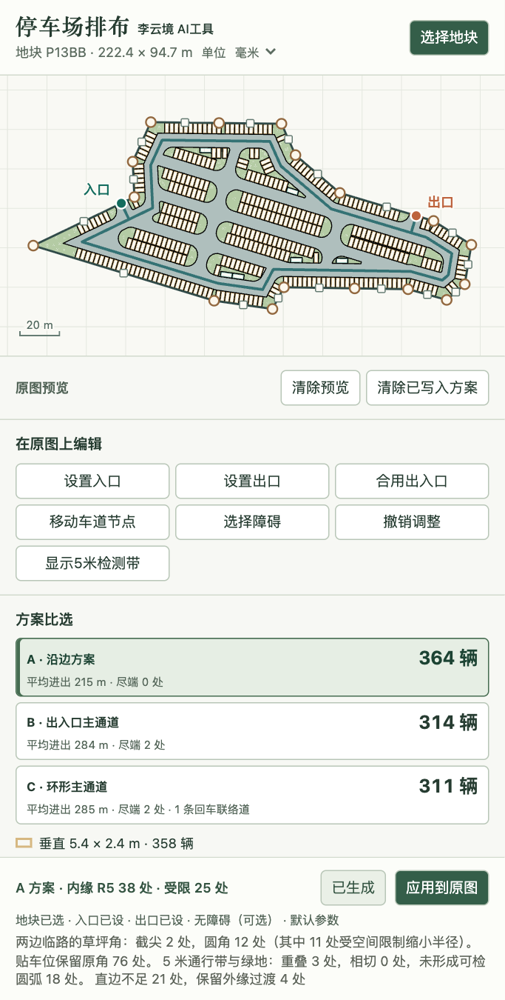

# 李云境 · 停车场 CAD 插件

在 CAD 里点选地块、标出入口和出口，就能生成三套停车场排布方案。点选 A、B、C 可对照车位数和通道，再把选中的方案写入原图，继续编辑车位、道路和绿地。

## 下载 Windows 免费版 3.9.3

[下载浩辰 CAD / AutoCAD 通用 ZIP](downloads/ParkingCAD-Windows-v3.9.3.zip?raw=true)。两款 CAD 都加载解压目录里的 `AIPPM.lsp`，操作步骤相同。

> **生成前请先保存所有 CAD 图纸，单独打开待排图纸。** 地块过大或单位选错，生成时可能导致 CAD 闪退。

## 安装与使用

1. **安装要加载两遍。** 完整解压，在 CAD 输入 `APPLOAD`，选解压目录里的 `AIPPM.lsp`，点「加载」再点「关闭」。随后再选同一个文件。如果没有弹窗，再输入 `APPLOAD` 加载一次。
2. **画框要用 C 闭合。** 在模型空间用 `PL` 画直边多段线，画到最后一个顶点，输入 `C` 并回车。输入 `TCCSC` 打开插件，点「选择地块」并选中这条轮廓。
3. **核对单位。** 看面板显示的地块长宽。如果实际长 80 米却显示为 80000 米，把「单位」改为「毫米」，再选一次地块。
4. **生成并写回。** 设置入口、出口，点「开始生成」，选中方案后点「应用到原图」。换地块时再点顶部的「选择地块」。

## 版本与兼容性

每个方案可排 **1 至 1500 个车位**。排不下一个车位，或排到第 1501 个时，面板提示「轮廓大小错误」。先核对图纸单位。单块外轮廓面积超过 **50,000 平方米**时，插件会在排布前停止。确认单位正确后，可将大型地块分区生成。

通用包内含 64 位浩辰 CAD 2023/2024 和 Windows AutoCAD 完整版 2018–2026 的面板组件，需要 Microsoft Edge WebView2 运行时。旧代 CAD 还需 .NET Framework 4.8。若没有弹出窗口，按 F2 查看版本和加载提示。3.9.3 沿用 3.9.2 的 CAD 面板组件。

